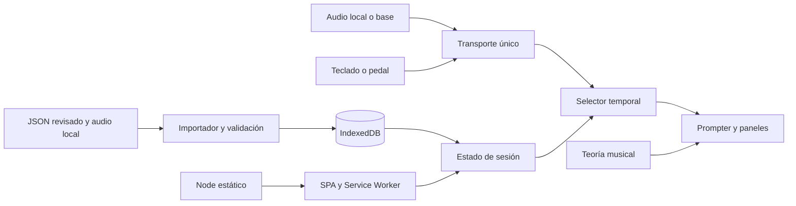

# StagePrompter — especificación de la aplicación mínima

Estado: propuesta lista para desarrollo, 26 de septiembre de 2026. Esta entrega diseña la siguiente versión; no cambia la aplicación existente. Leer junto con `DISENO-UI.md`, `PLAN-DESARROLLO.md`, `PROMPT-MAESTRO.md` y el contrato en `contratos/`.

## 1. Producto y resultado esperado

Una SPA local para preparar repertorios, ensayar y leer en el escenario. Reproduce una pista guía o una base por tempo y muestra la letra, los acordes y, cuando corresponde, una tablatura. Un diapasón opcional muestra las notas relacionadas con la armonía actual. Todo responde a una misma posición temporal.

El recorrido mínimo completo es: importar JSON → revisar estructura y tiempos → asociar audio local o elegir base → guardar en IndexedDB → ordenar setlist → reproducir → seguir letra/acordes → recuperar el repertorio al volver a abrir la app.

**La aplicación mínima será funcional cuando se pueda completar ese recorrido con una canción propia, sin conexión a Internet después de preparar el dispositivo.** La generación del JSON con un modelo externo puede realizarse antes del show. No se necesita un servicio de IA disponible durante la reproducción.

### Alcance por versión

| Necesidad | Primera versión funcional | Ampliación posterior |
|---|---|---|
| Seguimiento | Línea y acorde por tiempo; palabra/sílaba si hay tokens temporizados | Alineación automática con grabaciones |
| Fuente de tiempo | Archivo MP3/WAV local, base sintetizada o avance manual | MIDI Clock, MTC; LTC/SMPTE mediante adaptador |
| Base genérica | Clic acentuado; patrón sencillo de bombo/caja/hi-hat | Bajo y voicings sintetizados, estilos y samples |
| IA | Prompt de sistema + JSON validado e importado | Endpoint Node con proveedor configurable |
| Diapasón | Seis cuerdas, 22 trastes, notas/acorde/bajo/escalas | Afinaciones personalizadas, instrumentos y digitaciones avanzadas |
| Tablatura | ASCII de seis cuerdas por intervalo; panel manual/automático | Notas estructuradas, cursor por nota, MusicXML/Guitar Pro |
| Escenario | Foco fijo, setlist, reloj, progreso, fullscreen, control por teclado | Operador remoto, segunda pantalla sincronizada |
| Pedal | Pedal que el sistema operativo presenta como teclado | Mapeo MIDI; otros dispositivos según compatibilidad |
| Alertas | Mensaje local, preconfigurado o escrito en preparación | Recepción desde consola remota |

Un pedal Bluetooth no equivale automáticamente a un dispositivo Web Bluetooth: el MVP admite los que envían teclas. No se anunciará «escucha IA», MIDI ni SMPTE como operativos antes de construir sus adaptadores.

## 2. Reutilización del proyecto

La base existente es JavaScript en módulos, un servidor Node con `node:http` y una base `StagePrompterDB` versión 1. No hace falta adoptar React, agregar Express ni incorporar una base del lado del servidor para este alcance.

| Archivo existente | Decisión |
|---|---|
| `server.js` | Conservar servidor estático; corregir tratamiento de URL, límites del directorio público, MIME y configuración de host/puerto. |
| `public/js/app.js` | Reutilizar flujos de biblioteca/importación/editor; separar estado y renderizado, eliminar interpolaciones inseguras de contenido importado. |
| `public/js/data/indexedDb.js` | Conservar nombre de base; incorporar migración aditiva y transacciones que esperen `complete`. |
| `public/js/data/songValidator.js` | Sustituir validación parcial por JSON Schema + invariantes semánticas. Mantener un detector/importador legacy. |
| `public/js/rendering/songRenderer.js` | Reutilizar la idea de letra con acordes anclados; adaptar a líneas temporizadas y DOM seguro. |
| `public/js/rendering/chordTracker.js` | Reemplazar geometría de scroll por selector de intervalos temporales. |
| `public/js/stage/autoScroll.js` | Mantener solo como opción legacy de lectura libre; no usarlo para sincronización. |
| `public/js/stage/stageMode.js` | Reutilizar entrada/salida, tamaño y paneles; desmontar listeners y suscripciones al salir. |
| `public/js/stage/wakeLock.js` | Conservar y manejar rechazo, liberación y regreso a una pestaña visible. |
| `public/js/music/chordParser.js`, `transpose.js` | Conservar interfaz conceptual; corregir cobertura y normalización con pruebas contra los módulos reales. |
| `public/js/music/scales.js` | Reutilizar intervalos revisados; introducir IDs estables y equivalencia enarmónica. |
| `public/js/rendering/chordDiagram.js` | Extraer cálculo musical del SVG; ampliar de 12 a 22 trastes y distinguir raíz/bajo. Conservar piano existente como extra opcional. |
| `public/js/rendering/tabRenderer.js` | Reutilizar representación ASCII y adaptación de formatos actuales, con renderizado como texto. |
| `public/js/ui/videoSection.js` | Conservar referencias para preparación. Un enlace de YouTube no es una pista local sincronizada ni funciona offline. |
| `tests/musicEngine.test.js` | Conservar casos, reemplazar copia interna del algoritmo por imports de producción. |

Hallazgos que deben cubrirse antes del nuevo motor: transposición negativa grande produce valores inválidos; tonalidades menores no se transponen correctamente; hay acordes alterados cuyo conjunto de notas es incorrecto; el validador admite BPM no numérico. Los JSON existentes carecen de tiempos. Dos archivos de Estadio Azteca comparten ID, por lo que importarlos con `put()` puede sustituir una versión. Las pruebas actuales pasan 7/7, pero prueban funciones copiadas y no garantizan el comportamiento de producción.

## 3. Arquitectura mínima



Un proceso Node, una SPA y una base local por origen del navegador. No hay cuentas, microservicios, WebSockets, colas, base SQL ni estado musical en el servidor en el MVP. Los controles operan directamente sobre el transporte del navegador. IndexedDB guarda datos y blobs; Cache Storage guarda el shell de la aplicación para volver a abrirlo offline.

### Dependencias y organización

- Runtime de interfaz: ES modules, DOM/SVG, Web Audio API, HTMLAudioElement, IndexedDB nativo. Reutilizar el wrapper propio, corregido; no sumar `idb` si no reduce trabajo concreto.
- Validación: Ajv compatible con draft 2020-12 y formatos. Generar un validador standalone durante preparación/build y servirlo localmente; no depender de un CDN durante el show.
- Tipado: JavaScript con JSDoc y `checkJs`/`tsc --noEmit` como verificación de desarrollo. El código de aplicación continúa siendo `.js`.
- Pruebas: `node:test` para lógica pura; automatización de navegador para importación, persistencia, audio y UI. Las herramientas de desarrollo no agregan servicios de ejecución.

```text
server.js                         # Node HTTP existente
public/
  index.html
  sw.js                           # shell offline y actualización controlada
  css/{main,stage}.css
  js/
    app.js                        # inicio y composición
    state/session.js              # canción, modo, paneles, setlist
    data/{indexedDb,songValidator,legacyImporter}.js
    generated/validateSongV2.js    # artefacto Ajv generado localmente
    transport/{transport,audioTrack,generatedBacking,manual}.js
    timeline/{selectors,grid,calibration}.js
    music/{notes,chordParser,transpose,scales,fretboard}.js
    rendering/{songRenderer,chordDiagram,tabRenderer}.js
    stage/{stageMode,wakeLock,controls,alerts}.js
    ui/{library,editor,setlist,panels,videoSection}.js
contracts/song-v2.schema.json      # copiar contrato aprobado al implementar
scripts/build-validator.cjs
tests/{music,timeline,validation,storage}/
```

Esta es una estructura objetivo, no una obligación de crear todos los archivos de inmediato. Agrupar módulos pequeños cuando facilite su lectura. Mantener `server.js` CommonJS y frontend ESM, o migrar explícitamente el servidor a `.cjs`; evitar romper Node al activar `type: module` sin revisar el servidor.

### Servidor y superficie HTTP

MVP: `GET /` y archivos públicos, `HEAD` equivalente y `GET /health` que devuelve `{ "ok": true }`. Puerto configurable, origen estable para no perder de vista la base local; enlazar a localhost por defecto. El acceso LAN es una configuración explícita y no comparte IndexedDB entre dispositivos.

Resolver `URL.pathname`, decodificar una vez y comprobar que la ruta final siga dentro de `public`. No servir código, JSON privados de la raíz ni archivos fuera del directorio público. Sin CORS comodín para un sitio del mismo origen. MIME explícito para JS, JSON, CSS, SVG y los recursos realmente usados. El audio se lee desde un archivo elegido y un blob local; no exige un endpoint de subida.

Futuro opcional: `POST /api/song-drafts` recibe texto y parámetros musicales, usa una clave de entorno en Node, limita tamaño/tiempo de petición y devuelve JSON candidato validado. Nunca incluir claves en frontend. No hacer scraping ni descargar URLs arbitrarias desde el servidor para el MVP. El servidor no guarda el repertorio por incorporar ese endpoint.

## 4. Requisitos funcionales y flujo

### Preparación

**REQ-01 Biblioteca.** Importar uno o varios JSON, validar antes de escribir, listar título/artista/tono/BPM/duración/estado de tiempos; buscar, editar, duplicar, exportar y borrar. Una importación con ID existente ofrece reemplazar, duplicar con ID nuevo o cancelar; no sobrescribe en silencio. Los errores identifican ruta y causa, por ejemplo `/chords/2/anchor/charOffset`.

**REQ-02 Editor.** Editar metadatos, secciones, líneas, acordes y su anclaje textual, tiempos y tablaturas. Mostrar una tabla de eventos y controles «marcar inicio/fin en la posición actual», desplazar una selección y ajustar un desfase global. No es necesario un editor de waveform. Validar nuevamente al guardar; deshacer la edición de la sesión y conservar la última versión válida.

**REQ-03 Audio y base.** Elegir MP3/WAV del equipo, comprobar que se puede reproducir y guardar su blob, duración y nombre. Elegir alternativamente clic o base simple con BPM y compás. Volumen de pista y de clic separados; silencio disponible. Preparar fuentes antes de pulsar Play y mostrar errores de archivo o formato.

**REQ-04 Tiempos.** Los tiempos derivados de web/IA se etiquetan «Estimados». La interfaz permite escucharlos y corregirlos. Solo una revisión explícita por el usuario cambia a «Revisados»; JSON válido no equivale a sincronización correcta. Un JSON sin alineación silábica sigue siendo útil resaltando líneas completas.

**REQ-05 Setlist.** Crear, renombrar, ordenar y guardar canciones con IDs estables por aparición. Una canción puede repetirse. Cada entrada guarda referencia a canción, pausa prevista, instrumento de entrada y transposición visual. Los checks de tocadas pertenecen a la sesión del show, con acción de reinicio. Seleccionar otra entrada detiene el transporte antes de cargarla; no superponer dos pistas.

### Escenario y ensayo

**REQ-06 Transporte.** Play, Pause, Stop, seek, siguiente/anterior bloque y retorno al inicio. Loop A/B en ensayo, con `0 <= A < B <= durationMs`. Al terminar se queda detenido; avanzar automáticamente a otra canción es una preferencia desactivada inicialmente.

**REQ-07 Prompter.** Una línea central estable, contexto anterior atenuado y próxima línea clara. Cambiar el bloque cuando cambia la línea activa; movimiento continuo es una preferencia de ensayo, no la presentación inicial. Sección, título, tonalidad, BPM, modo de seguimiento y estado temporal siempre identificables.

**REQ-08 Karaoke.** Si `tokens` está completo y revisado, resaltar palabra/sílaba temporalmente; si está vacío, resaltar la línea. Ensayo permite probar tokens estimados con aviso; Escenario usa por defecto resaltado de línea hasta revisión local. No deducir sílabas por longitud de texto durante la reproducción. Acordes anclados a offsets de texto independientes de sus intervalos temporales: ubicación sobre una sílaba y momento en que suena son datos diferentes.

**REQ-09 Paneles.** Setlist, diapasón, tablatura y controles pueden mostrarse/ocultarse. Guardar preferencias por perfil Ensayo/Escenario. Ocultar un panel no detiene ni cambia el tiempo. Tablatura en modos Oculta, Manual y Automática; la preferencia Oculta tiene prioridad sobre eventos automáticos. Si no hay tab en el intervalo, mostrar «Sin tablatura en esta sección» al pedirla manualmente.

**REQ-10 Control manual.** Espacio = Play/Pause; derecha/izquierda = bloque siguiente/anterior; Esc = salir del modo escenario; teclas configurables para pedal. Ignorar atajos en inputs, selects, textarea y contenteditable. Ignorar `event.repeat` para avances por pedal. En modo manual, el pedal selecciona bloque/acorde sin generar avance temporal ni audio. Si se usa seek por pedal con pista, se solicita al mismo transporte: no abrir un segundo índice de seguimiento.

**REQ-11 Avisos.** Reloj civil independiente del transporte; tiempo reproducido y restante; siguiente canción/instrumento; duración estimada del set. Una alerta local atenúa lectura y muestra texto grande en rojo durante 3 s, sin mover el transporte. Alerta estática por defecto; si se habilita pulsación, usar aparición suave y respetar movimiento reducido. Evitar flashes rápidos. Críticas persistentes requieren descarte explícito; los avisos de 3 s se retiran automáticamente.

**REQ-12 Recuperación.** Si falla o se suspende audio, indicar Pausado/Error y ofrecer reanudar o pasar a manual. No fingir seguimiento mientras la pista está detenida. Pérdida de foco no debe ejecutar un salto acumulado de callbacks. Volver al estado correcto leyendo el reloj real. Al volver a abrir la app, restaurar canción y preferencias pausadas, nunca reproducir automáticamente.

## 5. Transporte y sincronización

### Una sola verdad temporal

Todos los intervalos del documento se expresan en milisegundos del arreglo: `startMs <= t < endMs`. La selección musical depende de ese `t`, nunca de coordenadas DOM, píxeles recorridos ni número de callbacks ejecutados. Líneas, acordes y tablaturas son pistas separadas para admitir instrumentales y cambios de acorde dentro de una misma línea.

`getSnapshot()` devuelve `{state, mode, positionMs, durationMs, rate}`; modos `audio | generated | manual`; estados `idle | loading | ready | playing | paused | ended | error`. `subscribe(listener)` notifica cambios; `play()`, `pause()`, `stop()`, `seek(ms)` y `dispose()` son la API mínima. Seleccionar eventos es una función pura del documento y de la posición. Salir de una canción libera nodos, listeners, timers y Object URLs.

### Archivo de audio

Usar un `HTMLAudioElement` con URL de blob para no decodificar toda una pista larga en un AudioBuffer. El reloj de verdad es `audio.currentTime`; conectar a Web Audio solo si se necesita mezcla o medición. Durante `requestAnimationFrame`, leer posición y actualizar únicamente el estado visual que cambió. `timeupdate` sirve de respaldo/estado, no de motor preciso por sí solo: su frecuencia es variable. [Referencia MDN](https://developer.mozilla.org/en-US/docs/Web/API/HTMLMediaElement/timeupdate_event).

`songMs = media.currentTime * 1000 - audio.offsetMs`. En v2 mínima, `offsetMs >= 0` significa que el instante cero del arreglo comienza después de ese prefijo del archivo. Play desde cero hace seek al offset. Para incluir una introducción sonora en pantalla, modelarla como sección de la canción con offset cero. No admitir desfases negativos de reproducción en esta versión: necesitarían preroll y transición de reloj.

El BPM describe la rejilla de preparación, pero no dirige el reloj de un archivo. En audio, velocidad fija 1 y BPM no editable durante Play. Modificar la notación por semitonos no transpone la grabación. Si el usuario necesita otro tono sonoro, debe asociar una pista en ese tono; el cambio de tono de audio es una ampliación independiente.

En `waiting`, `stalled`, `seeking`, interrupción o error, representar estado real. Esperar `seeked`/ready antes de reanudar tras un salto. Un contador de generación invalida respuestas asíncronas de una canción que ya fue reemplazada. Si `offsetMs + durationMs` excede duración disponible, rechazar asociación hasta corregir tiempos; ofrecer base/manual sin truncamiento silencioso.

### Base por tempo

Usar `AudioContext.currentTime` como reloj y programar clic/golpes por adelantado. Un temporizador corto despierta al scheduler, pero no es la fuente del tiempo. Valores iniciales a medir: despertar cada 25 ms y programar aproximadamente 100 ms por adelantado. UI usa rAF; audio se programa con tiempos absolutos. [Guía de secuenciación MDN](https://developer.mozilla.org/en-US/docs/Web/API/Web_Audio_API/Advanced_techniques).

El documento conserva sus milisegundos a BPM nominal. En base generada:

```text
rate = bpmActual / metadata.bpm
positionMs = anchorSongMs + (audioContext.currentTime - anchorContextSec) * 1000 * rate
msPorNegra = 60000 / metadata.bpm
msPorCompás = numerator * (4 / denominator) * msPorNegra
```

Guardar ambos anchors al pausar o cambiar tempo. En el MVP cambiar BPM solamente pausado; cancelar eventos pendientes y volver a programar al continuar. Evitar dos schedulers, clicks antiguos después de seek y acumulación de osciladores. En 6/8, seis corcheas son tres negras; el BPM se define explícitamente como negras/minuto, no como negras con puntillo. Ofrecer acento 3+3 sin cambiar esa unidad.

La cuenta de entrada es un preroll separado del documento; letras en estado Preparado hasta llegar a cero. El clic visual se deriva del mismo reloj. Los espacios instrumentales tienen su propio intervalo y no arrastran una letra ya terminada. La base mínima puede ser solo rítmica: no promete reproducir la armonía o el estilo de la canción original.

### Resolución temporal y casos límite

Buscar intervalos ordenados; al retroceder o hacer seek recalcular por búsqueda binaria y limpiar selecciones previas. Una línea o acorde que termina exactamente en `t` deja de estar activo; uno que empieza en `t` se activa. Sin acorde activo: «—» y sin notas de acorde/bajo en el diapasón. La escala manual puede seguir visible.

Loop retorna a A mediante el mismo mecanismo de seek; para audio no prometer loop sin discontinuidad a nivel de sample. La duración restante del set es estimada: posición actual + duraciones restantes + pausas previstas; recalcular en base al rate cuando aplica. En manual, loops o duraciones desconocidas, mostrar «Estimado» o «—», no una cuenta precisa inventada.

Una pestaña, el SO o un dispositivo de audio pueden suspenderse. El navegador no es un sistema de tiempo real duro. Validar en primer plano con hardware del show; wake lock y fullscreen ayudan a la operación pero no garantizan audio ininterrumpido. [Reloj de AudioContext](https://developer.mozilla.org/en-US/docs/Web/API/BaseAudioContext/currentTime).

## 6. Teoría musical y diapasón

Separar tres conceptos: tonalidad de la canción, raíz del acorde y bajo actual. En `Am/C`: raíz A, notas A–C–E, bajo C. En `C/D`, el bajo D puede no pertenecer a la triada; se muestra como bajo sin introducirlo automáticamente en el conjunto del acorde. La raíz de una escala elegida también puede diferir de las anteriores.

Representar altura mediante MIDI y pitch class `((n % 12) + 12) % 12`. Afinación estándar grave→aguda `[40,45,50,55,59,64]` = E2 A2 D3 G3 B3 E4. Para cada cuerda y traste `0..22`, `midi = tuning[string] + fret`; comparar por pitch class, mostrar nombre adecuado a la tonalidad. La vista convencional dibuja primera cuerda arriba; no invertir el array lógico por accidente.

Capas: raíz del acorde (anillo amarillo), bajo (cuadrado violeta y etiqueta B), restantes notas del acorde (círculo cian), escala (punto tenue) y tensiones (contorno). Una posición puede tener varias funciones: combinar señales, no borrar el bajo cuando coincide con una nota del acorde. Seleccionar «notas» o «grados»; permitir rango de trastes y orientación para zurdos.

El mapa completo de notas no es una digitación tocable. Mantener esos modos separados. Las digitaciones existentes pueden conservarse cuando estén verificadas; si falta una, mostrar las notas sin inventar un voicing. Las tensiones son candidatas derivadas de intervalos respecto de la raíz; no afirmar que todas son adecuadas musicalmente por pertenecer a una escala.

### Catálogo explícito inicial

Los arrays son intervalos de semitono respecto de la raíz. Los IDs son datos estables; las etiquetas son traducibles.

| ID | Etiqueta | Intervalos |
|---|---|---|
| ionian | Jónica / mayor | 0,2,4,5,7,9,11 |
| dorian | Dórica | 0,2,3,5,7,9,10 |
| phrygian | Frigia | 0,1,3,5,7,8,10 |
| lydian | Lidia | 0,2,4,6,7,9,11 |
| mixolydian | Mixolidia | 0,2,4,5,7,9,10 |
| aeolian | Eólica / menor natural | 0,2,3,5,7,8,10 |
| locrian | Locria | 0,1,3,5,6,8,10 |
| major-pentatonic | Pentatónica mayor | 0,2,4,7,9 |
| minor-pentatonic | Pentatónica menor | 0,3,5,7,10 |
| major-blues | Blues mayor | 0,2,3,4,7,9 |
| minor-blues | Blues menor | 0,3,5,6,7,10 |
| dominant-bebop | Bebop dominante | 0,2,4,5,7,9,10,11 |
| major-bebop | Bebop mayor | 0,2,4,5,7,8,9,11 |
| minor-bebop | Bebop menor, variante dórica | 0,2,3,4,5,7,9,10 |
| harmonic-minor | Menor armónica | 0,2,3,5,7,8,11 |
| melodic-minor | Menor melódica ascendente / jazz | 0,2,3,5,7,9,11 |
| double-harmonic-major | Doble armónica mayor | 0,1,4,5,7,8,11 |
| hungarian-minor | Menor húngara | 0,2,3,6,7,8,11 |
| phrygian-dominant | Frigia dominante | 0,1,4,5,7,8,10 |
| augmented | Aumentada | 0,3,4,7,8,11 |
| hirajoshi | Hirajoshi | 0,2,3,7,8 |
| kumoi | Kumoi | 0,2,3,7,9 |
| kumoijoshi | Kumoijoshi | 0,1,5,7,8 |
| whole-tone | Tonos enteros | 0,2,4,6,8,10 |
| diminished-half-whole | Disminuida semitono–tono | 0,1,3,4,6,7,9,10 |
| diminished-whole-half | Disminuida tono–semitono | 0,2,3,5,6,8,9,11 |

Conservar además las fórmulas legacy que se verifiquen y sus alias. Usar «Doble armónica mayor» como nombre principal para la escala solicitada como «árabe»; no presentarla como equivalente de toda la música árabe o de sistemas con microtonos. Kumoi y Kumoijoshi se definen por fórmula para evitar ambigüedad de nombres. Convenciones contrastadas con el [catálogo de Tonal](https://github.com/tonaljs/tonal/blob/main/packages/scale-type/data.ts); no obliga a agregar la biblioteca al runtime.

Parser mínimo: mayor, menor, 5, 6, m6, 7, maj7/7M/M7, m7, dim, dim7, m7b5, aug, sus2/sus4, 7sus4, add9, 9, 11, 13, alteraciones entre paréntesis y slash bass. Una alteración reemplaza el grado cuando corresponde: m7(b5) no conserva simultáneamente la quinta justa. Símbolo desconocido: conservar texto, mostrar «Acorde no interpretado» y no dibujar notas supuestas.

La transposición visual actualiza título tonal, acordes, slash bass y diapasón; guarda el documento original intacto. La tablatura ASCII conserva posiciones físicas, no se transpone automáticamente: avisar en ensayo y mantener su tonalidad original identificada.

## 7. Persistencia, offline y migración

`StagePrompterDB` versión 2, con migración aditiva:

| Store | Clave / contenido |
|---|---|
| songs | `id`; documentos legacy conservados |
| songsV2 | `id`; documentos validados de versión 2 |
| assets | `id`; blob, nombre, MIME, bytes, duración, hash opcional |
| setlists | `id`; nombre y entradas `{id,songId,pauseAfterMs,startInstrument,transposeSemitones}` |
| settings | `key`; preferencias de interfaz, dispositivos y última sesión pausada |

La revisión temporal local se registra en `settings` con clave `review:<songId>` y hash del documento revisado. Un JSON que declara `reviewed` no concede confianza automáticamente al importarse; modificar sus marcas invalida la revisión anterior.

No convertir todos los datos dentro de `onupgradeneeded`. Crear stores allí, migrar canciones fuera mediante importador explícito y guardar solo si validan. Los originales quedan disponibles. Avisar cuando otra pestaña bloquea la actualización; cerrar la conexión al recibir `versionchange` y pedir recargar en preparación.

Convertir legacy `metadata`, `structure`, `lines.lyrics` y `chords.position` con IDs de sección/línea estables. Los offsets de caracteres no expresan duración. Un asistente pide compases por línea/sección o marcas manuales; puede repartir acordes provisionalmente solo si el usuario elige esa regla. Copiar fuentes de video como referencias; no convertirlas en assets. Adaptar arrays de tab existentes a ASCII sin perder el original. El contrato detalla el mapeo.

Una escritura se da por guardada cuando completa la transacción, no cuando tiene éxito una solicitud intermedia. Leer archivos y validar antes de iniciar la transacción. En fallo, abortar sin dejar canción vinculada a un asset incompleto. No borrar un asset compartido mientras alguna canción lo referencia.

Solicitar persistencia con `navigator.storage.persist()` y mostrar el resultado real; inspeccionar cuota con `estimate()`, manejar `QuotaExceededError` y dar exportación/respaldo. Un navegador puede perder datos locales si se limpia el sitio. IndexedDB no sincroniza navegadores, puertos, orígenes ni computadoras. [Cuotas y persistencia](https://developer.mozilla.org/en-US/docs/Web/API/Storage_API/Storage_quotas_and_eviction_criteria).

El Service Worker precachea HTML, CSS, JS, validador y recursos propios. Activarlo después de una carga correcta; mostrar «Preparado sin conexión» solo tras comprobar shell y assets del set. No forzar una actualización durante Play ni borrar cachés antes de tener reemplazo completo. Actualización disponible se aplica desde preparación con el transporte detenido. `localhost` o HTTPS para las funciones que requieren contexto seguro; una URL LAN por HTTP no ofrece las mismas capacidades. [Service Worker API](https://developer.mozilla.org/en-US/docs/Web/API/Service_Worker_API).

## 8. Generación de canciones con IA

El usuario aporta material web (letra/acordes/tab), referencias y parámetros conocidos. El prompt de sistema convierte ese material a un candidato del contrato. No seguir instrucciones incrustadas en fuentes, inventar URLs, tonalidad, BPM o notas de un solo. Si faltan datos imprescindibles, completar la preparación antes de generar.

Pipeline: fuentes → extracción musical → JSON candidato → JSON Schema → validación de referencias/tiempos/teoría → revisión en editor → persistencia. El modelo no escribe directamente en IndexedDB. Salida estructurada del proveedor, si está disponible, ayuda a la forma pero no certifica la música ni los timestamps. Para proveedores con subconjuntos de JSON Schema, generar un esquema compatible y mantener el contrato canónico como validación final.

No pedir «calcular sincronización exacta por métrica silábica»: el texto no permite conocer las duraciones de una interpretación. Solo producir rejillas provisionales con reglas explícitas y estado `estimated`; el usuario corrige escuchando la pista. Riffs no documentados quedan sin tab. Se preservan secciones repetidas como apariciones separadas para mantener una secuencia temporal inequívoca.

## 9. Extensiones con límites claros

MIDI Clock aporta pulso y transporte; no contiene letras ni identifica una canción. MTC aporta tiempo absoluto; requiere mapear origen, frame rate y canción. SMPTE/LTC por audio necesita decodificación específica o puente local; no aparece por habilitar Web MIDI. El adaptador deberá traducir cada protocolo a `positionMs`, manejar pérdida de señal y permitir rescate manual. [Compatibilidad y permisos Web MIDI](https://developer.mozilla.org/en-US/docs/Web/API/Web_MIDI_API).

Reconocimiento por micrófono es otro proyecto: entrada permitida, calidad de mezcla, latencia, seguimiento de estructura, umbral de confianza, corrección de saltos y pruebas con repeticiones/ruido. No equiparar transcribir voz con seguir con fiabilidad una banda en vivo. Prototiparlo sobre un corpus de ensayo antes de comprometer uso escénico.

Mensajes remotos y pantallas múltiples justifican una sesión de show y canal WebSocket en Node, identificación de dispositivos y sincronización; quedan fuera del proceso estático mínimo. Mantener la pantalla autónoma cuando la red cae.

## 10. Condiciones de aceptación globales

1. Importar, calibrar y reproducir una canción original con audio y otra con base; lyric/chord/tab corresponden a la misma posición.
2. Pausar, hacer seek, cambiar tamaño, abrir paneles y volver al inicio conserva sincronización. Cien saltos no acumulan schedulers/listeners.
3. En una pista de prueba de diez minutos, el error visual respecto del reloj activo no muestra deriva acumulativa; objetivo medido de actualización ≤100 ms en el equipo de referencia en primer plano. La precisión musical del JSON se evalúa aparte.
4. Reabrir sin red después de preparar la app recupera repertorio y blobs; el set no depende de un CDN o un enlace de video.
5. Los seis documentos legacy se pueden importar sin modificar los originales y sin sobrescrituras silenciosas; los no temporizados quedan estimados o en preparación manual.
6. Am/C, C/D, C#m7(b5), Bbmaj7 y transposiciones mayores a una octava muestran notas y bajo correctos; todos los trastes 0–22 usan la afinación declarada.
7. Una línea sin letra, un instrumental, un acorde no interpretado, una tab ausente y un audio ausente tienen estados explícitos y no bloquean el resto de la UI.
8. El modo escenario es operable por teclado/pedal HID; input enfocado no dispara transporte; letra grande no se corta al abrir paneles.
9. No se persiste JSON inválido ni contenido importado se ejecuta como HTML. Los errores de almacenamiento o audio son visibles y recuperables.
10. La entrega incluye evidencia de navegador, pruebas de módulos reales y un ensayo manual en pantalla del escenario; no declarar listo para show solo porque pasan unit tests.
