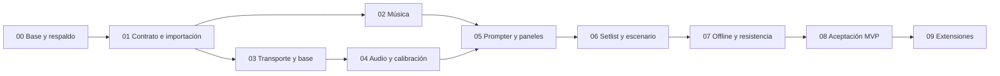

# Plan de desarrollo guiado por especificaciones

Estado: plan propuesto, sin implementación del MVP. Orden obligatorio por dependencias; cada etapa deja una demostración verificable. Documentos de referencia: `ESPECIFICACION.md`, `DISENO-UI.md`, `contratos/CONTRATO-DATOS.md` y `PROMPT-MAESTRO.md`.

## Método de trabajo

Para cada etapa crear una ficha corta con: problema, alcance, contratos afectados, ejemplos de entrada/salida, criterios Given/When/Then y evidencia de validación. Implementar una porción vertical, demostrarla y recién entonces comenzar su dependiente. Una etapa no termina por haber creado archivos o botones: debe satisfacer sus criterios.

Las ampliaciones no se ocultan detrás de botones que simulan estar conectados. Mantener estados de «No implementado» fuera de la pantalla escénica o no exponer esos controles. Actualizar documentación cuando cambie un contrato. No agregar un framework o servicio sin identificar primero qué requisito lo exige.

## Mapa de dependencias

Después de S1, teoría musical y transporte pueden desarrollarse en paralelo con contratos acordados. El render consume selectores temporales, no debe asumir cómo se obtiene el reloj.

## S0 — Proteger el punto de partida

**Objetivo:** poder comparar y recuperar el repertorio actual.

Tareas:

1. Crear control de versiones o copia de trabajo acordada; registrar todos los archivos actuales. No hay repositorio Git en la carpeta auditada.
2. Exportar biblioteca del navegador y respaldar JSON fuente sin modificarlos. Registrar origen exacto y nombre/versión de IndexedDB.
3. Ejecutar `npm test` y los casos manuales existentes; conservar resultado y su limitación: los siete tests actuales duplican funciones.
4. Crear fixtures de regresión de metadatos y conteos, sin redistribuir letras ajenas: 6 documentos, ID duplicado, modulaciones y tablaturas.
5. Acordar navegador de referencia y tamaños: escritorio 1920×1080, portátil 1366×768 y tablet 1024×768; móvil como preparación/consulta. Validar escenario en hardware real más adelante.

**Aceptación:** dado el proyecto actual, al preparar la rama/copia, todos los archivos y la biblioteca tienen una ruta de restauración; ninguna acción inicia una migración destructiva.

**Salida:** inventario, baseline de pruebas y procedimiento de recuperación. Esta etapa no incorpora funcionalidades nuevas.

## S1 — Contrato, validación y almacenamiento

**Objetivo:** importar una canción v2 y recuperar el mismo documento tras recargar.

Tareas:

1. Adoptar `song-v2.schema.json` como contrato canónico. Congelar nombres/unidades y publicar un changelog al cambiarlo.
2. Preparar validador Ajv local para navegador; habilitar formatos de URI/fecha y reglas semánticas fuera del schema. No confundir `required` con tipo válido.
3. Añadir JSDoc y verificación estática para los nuevos módulos JS; no convertir todo el proyecto a TypeScript.
4. Añadir stores `songsV2`, `assets`, `setlists`, `settings` a `StagePrompterDB`, conservando `songs` intacto. Manejar abort/error/blocked/versionchange.
5. Importar archivo, presentar errores por ruta y advertencias; resolver duplicado explícitamente. Validar antes de comenzar transacción.
6. Construir adaptador legacy para `metadata/structure/lyrics/chords.position/tab/references`. Conservar modulación de sección y referencias tutorial/estudio/vivo.
7. Pedir reglas de rejilla cuando no haya tiempos. Si no se proveen, abrir preparación manual y no inventar un playback temporizado. Mantener copia original asociada al proceso de importación.
8. Sustituir `innerHTML` con datos externos por nodos/textContent. No se pierde formato ASCII ni espacios.

**Aceptación Given/When/Then:**

- Dado el JSON original de demo, cuando se importa y recarga, entonces se recupera con los mismos IDs, anclas, eventos y tiempos.
- Dado BPM `"fast"`, un final anterior al inicio, un anchor inexistente o campos adicionales, cuando se importa, entonces no se escribe y se indica el problema.
- Dadas las dos variantes con el mismo ID, cuando se importa la segunda, entonces se elige reemplazar/duplicar/cancelar sin pérdida silenciosa.
- Dada DB v1 y una segunda pestaña abierta, cuando se actualiza, entonces se informa el bloqueo y se puede continuar tras cerrar/recargar la otra pestaña.

**Pruebas:** validación positiva/negativa real, rollback de transacción, lectura después de recarga y migración contra todos los fixtures legacy. Ningún test llama a un proveedor IA.

## S2 — Motor musical confiable

**Objetivo:** calcular armonía y posiciones sin depender del DOM.

Tareas:

1. Extraer `notes`, parser y cálculo de notas de `chordDiagram.js`. Un único parser alimenta transposición, texto y diapasón.
2. Normalizar sostenidos/bemoles a pitch class y conservar spelling de presentación. Corregir módulo negativo para cualquier semitono permitido.
3. Diferenciar raíz, bajo, tonalidad y raíz de escala; admitir modulaciones de sección.
4. Definir catálogo con IDs estables y fórmulas explícitas; conservar alias legacy revisados. Agregar Hirajoshi, Kumoi y Kumoijoshi.
5. Calcular 6×23 posiciones con afinación declarada; separar mapa de notas de voicings/digitaciones.
6. Sustituir tests copiados por imports de funciones productivas. Cerrar primero los fallos encontrados por la auditoría.

**Aceptación:**

| Entrada | Resultado que debe verificarse |
|---|---|
| C#m7(b5) | C#, E, G, B; no incluir G# |
| G7(b5) | G, B, Db, F (enarmonía C# permitida para pitch class) |
| C7sus4 | C, F, G, Bb; no E |
| Am/C | Raíz A, bajo C, notas A/C/E |
| C/D | Bajo D independiente de triada C/E/G |
| C transpuesto −13 | B; nunca `undefined` |
| Em transpuesto +2 | F#m, cabecera incluida |
| Bb con escala mayor | Pitch classes 10,0,2,3,5,7,9 |
| Cfoo | Texto preservado, estado no interpretado; ninguna triada inventada |

**Pruebas:** 12 raíces × catálogo, 0/12/22 trastes, equivalencia enarmónica, roundtrip de transposición y alteraciones. Verificar la convención de cuerdas con un ejemplo sonoro/documentado; no copiar la inversión legacy de `string:1`.

## S3 — Transporte único, timeline y base

**Objetivo:** reproducir la demo de 32 s con clic y observar eventos sincronizados en un inspector sencillo.

Tareas:

1. Definir máquina de estados y API `play/pause/stop/seek/getSnapshot/subscribe/dispose`.
2. Implementar selectores puros para sección, línea, token, acorde y tab; intervalos semiabiertos, búsqueda por tiempo y eventos vacíos.
3. Implementar reloj de base con AudioContext, anchors y scheduler adelantado. Clic y patrón rítmico básico de volumen moderado; iniciar audio solo desde gesto del usuario.
4. Añadir compás, acento, cuenta de entrada y fórmula de tempo nominal/actual. Cambio de BPM pausado inicialmente.
5. Implementar modo manual con índice de bloque y sin audio. Teclado/pedal HID envían acciones al transporte.
6. Detener nodos programados y cancelar callbacks al hacer seek/dispose. Una generación de sesión invalida trabajo antiguo.

**Aceptación:** pausar 5 s y continuar no avanza la canción durante la pausa; seek a 0, frontera de acorde y final selecciona eventos correctos; repetir Play no duplica scheduler; cuenta previa no consume letras; 6/8 respeta la unidad de negra especificada.

**Pruebas:** reloj inyectado con tiempos deterministas, fronteras exactas, huecos, final, avance/retroceso y cien secuencias de play/pause/seek. Prueba real de audio en navegador para verificar el clic; una simulación de reloj no valida la salida audible.

## S4 — Audio local y editor de sincronización

**Objetivo:** asociar un archivo real y corregir tiempos escuchándolo.

Tareas:

1. Guardar blob, nombre, tipo, tamaño y duración en assets; Object URLs solo durante sesión, revocadas al cerrar.
2. Adaptar HTMLAudioElement al mismo transporte; reloj `currentTime`, handling de loading/seeking/ended/error y autoplay rechazado.
3. Alinear mediante offset positivo y marcas de evento; comprobar longitud de pista contra arreglo.
4. Editor de tabla: seleccionar línea/acorde/tab, marcar inicio/fin, mover selección y reproducir fragmento. Límites, orden y referencias vuelven a validarse al guardar.
5. Mostrar estado «Estimado»/«Revisado»; revisar no se activa automáticamente por guardar o validar schema.
6. Loop A/B de ensayo, volumen y mute; BPM bloqueado durante reproducción de audio.

**Aceptación:** pista sintética con golpes a tiempos conocidos, letra y acordes cambian al pasar las marcas; pausa/seek conserva sincronía; cambiar fuente detiene la anterior; audio inválido no destruye la canción. Un archivo insuficiente para offset+duración se rechaza con opción de recalibrar o usar base/manual.

**Pruebas:** selección de archivo, guardado/recarga, seeked, archivo ausente/corrupto y desasociación de asset compartido. Objetivo de error visual medido ≤100 ms en el equipo de referencia; reportar limitaciones de hardware. No confundirlo con precisión de timings inferidos por IA.

## S5 — Prompter y paneles musicales

**Objetivo:** completar el recorrido musical con una pantalla de lectura usable.

Tareas:

1. Implementar la distribución de `DISENO-UI.md`: foco central, contexto anterior/siguiente, encabezado y anticipación inferior.
2. Anclar acordes a spans de texto mediante offsets UTF-16 validados; segmentación visual segura sin cortar pares surrogate ni clusters visibles. No calcular tiempo a partir del ancho.
3. Resaltado por línea cuando no hay tokens; por palabra/sílaba cuando existen y están validados.
4. Adaptar SVG existente a 22 trastes; capas de raíz/acorde/bajo/escala, selector de escala y modo seguir/fijar raíz.
5. Tablatura ASCII sincronizada por bloque, no por nota; modalidad oculta/manual/automática. Tablatura no se transpone silenciosamente.
6. Hacer paneles accesibles y persistir preferencias. Al abrir panel en pantalla pequeña mantener tamaño mínimo de letra, moviendo el panel a otra región/vista.

**Aceptación:** cambiar tipografía, orientación o paneles no cambia el acorde activo; Am/C muestra raíz A y bajo C; entrar en solo muestra la tab correspondiente si modo automático; ocultarla evita reapertura no solicitada; canción sin letra muestra Instrumental con acorde/compás.

**Pruebas:** teclado, focus, contraste, 200% zoom en preparación y capturas a los tamaños acordados. Verificar acordes largos y líneas largas sin colisión ni corte. Revisar visualmente el resultado real; los snapshots no sustituyen la lectura a distancia.

## S6 — Show, setlist y manejo escénico

**Objetivo:** tocar dos o más canciones seguidas con control de escenario.

Tareas:

1. Persistir y ordenar setlists; admitir canción repetida mediante ID de entrada.
2. Mostrar actual/tocadas/próximas, instrumento que entra y tiempo restante estimado del show. Tratar final de set y set vacío.
3. Modo escenario con fullscreen y Wake Lock por detección de soporte, sin bloquear si se rechaza. Recuperar correctamente listeners al entrar/salir.
4. Mapear pedal/teclas, ignorar repeticiones y foco de edición. Añadir prueba de pedal desde preparación.
5. Alertas locales de 3 s y críticas persistentes con prioridad; no detener audio ni perder tiempo al cerrarlas.
6. Definir «seleccionar siguiente» frente a «iniciar siguiente»; autoplay de siguiente canción desactivado por defecto.

**Aceptación:** avanzar canción detiene audio anterior y carga la elegida; terminar canción no dispara otra sin preferencia; una repetición en setlist no cambia el documento original; alerta vuelve a la posición temporal actual; salir/reentrar no duplica controles.

**Pruebas:** show de 3 entradas con una repetida, fin de repertorio, cambio manual inesperado, teclado en input y pedal HID real cuando esté disponible. Declarar si el dispositivo físico no se pudo probar.

## S7 — Offline y resistencia

**Objetivo:** poder preparar, desconectar y ejecutar el set con recuperación de fallos previsibles.

Tareas:

1. Service Worker con shell versionado y todos los recursos locales; no precachear contenido externo ni claves.
2. Verificación «Preparado sin conexión» basada en shell y assets del set, no en que `navigator.onLine` sea true.
3. Cuota/persistencia, errores de escritura, exportación JSON y respaldo de medios. Un export de canciones no lleva audio salvo opción explícita de paquete.
4. Actualizaciones disponibles aplicables con transporte detenido; retener caché anterior hasta completar reemplazo.
5. Confinar servidor a `public`, parsear URL/query, soportar HEAD y health; cerrar CORS no requerido.
6. Auditar imports y render para que los datos sean texto. Limitar tamaños razonables y mostrar errores legibles.

**Aceptación:** tras primera preparación y recarga controlada por SW, desconectar Internet y detener Node; volver a abrir el mismo origen permite cargar SPA, canciones y audio local. Si el navegador no permite ese modo en el entorno elegido, documentar el límite y mantener Node local como alternativa verificada. No afirmar offline completo solo porque IndexedDB guarda canciones.

**Pruebas:** red offline real del navegador, origen/puerto distinto, asset faltante, cuota agotada, actualización en pausa/Play, cierre abrupto antes de commit y suspensión de pestaña. Recuperación siempre pausada, sin reproducción automática.

## S8 — Cierre de MVP

**Objetivo:** entregar una versión demostrable y una lista explícita de límites.

Ejecutar este guion de extremo a extremo:

1. Importar la demo v2; importar una canción legacy con reglas de rejilla elegidas y una variante duplicada.
2. Asociar una pista original, corregir tres marcas y declarar revisión manual.
3. Crear setlist, duplicar una entrada y guardar.
4. Ensayar con pista; pausar, seek, loop, transponer notación y abrir paneles.
5. Cambiar a base, ajustar BPM pausado y reproducir con diapasón y tab.
6. Entrar en escenario, operar con teclado/pedal, lanzar aviso y terminar canción.
7. Recargar offline, recuperar repertorio y comprobar audio persistido.
8. Ejecutar pruebas automatizadas, evaluar memoria/listeners tras cien saltos y correr diez minutos sin deriva acumulativa.
9. Probar lectura a distancia de 2–4 m con una pantalla representativa, luz y tamaño de fuente de show; registrar observaciones de un músico.

**Entregables:** código, instrucciones de inicio, ejemplos originales, contratos, tests de módulos reales, evidencia de navegador, respaldo/migración, errores conocidos y tabla soportado/no soportado. No incluir MIDI/IA acústica en capacidades confirmadas.

## S9 — Evolución posterior, por necesidad

| Extensión | Trabajo concreto | Condición para promover a uso real |
|---|---|---|
| Generación IA integrada | Endpoint Node, proveedor, validación, errores/reintentos y revisión de borrador | JSON inválido nunca persiste; claves solo servidor; fallos no afectan show |
| MIDI Clock | Mensajes transport/clock/SPP, mapear pulsos a tiempo y detectar pérdida | Prueba con DAW y dispositivo reales, reconexión y salto fiables |
| MTC/LTC | Decodificación, framerate/origen, mapeo de canción y puente si hace falta | Pruebas de offset, discontinuidades y pérdida; no confundir Clock con timecode |
| Seguimiento por micrófono | Captura, reconocimiento/alineación, confianza y recuperación manual | Corpus con repetición, ruido y cambios de tempo; métricas de saltos erróneos/latencia |
| Operador remoto | Sesión de show, WebSocket, identificación y mensajes priorizados | Caída de red no detiene pantalla; control de quién puede enviar avisos |
| Tabs por nota | Eventos cuerda/traste/duración/técnica y renderer | Semántica y convención de cuerdas verificadas; importar/exportar sin pérdida |
| Audio a otro tono/velocidad | DSP independiente de transposición visual | Calidad y latencia medidas; no degradar el MVP por agregarlo |

## Trazabilidad y definición de terminado

| Requisito de producto | Etapa | Evidencia principal |
|---|---|---|
| REQ-01 Biblioteca | S1 | Import válido/inválido, duplicados, recarga |
| REQ-02 Editor | S1 + S4 | Cambios temporales auditables y guardado validado |
| REQ-03 Fuente audio/base | S3 + S4 | Audio real y clic programado |
| REQ-04 Tiempos honestos | S1 + S4 | Estado estimado/revisado, reglas explícitas |
| REQ-05 Setlist | S6 | Persistencia y canciones repetidas |
| REQ-06 Transporte | S3 + S4 | Máquina de estados, seek y loop |
| REQ-07/08 Lectura/karaoke | S5 | Misma selección ante cambios de layout |
| REQ-09 Paneles | S2 + S5 | Diapasón musicalmente correcto y tab temporal |
| REQ-10 Pedal | S3 + S6 | Teclas sin repetición ni interferencia con inputs |
| REQ-11 Avisos | S6 | Mensaje sobre transporte continuo |
| REQ-12 Recuperación/offline | S4 + S7 | Suspensión, recarga, asset/cuota/DB fallidos |

Cada cierre registra: criterios cumplidos, comandos ejecutados, pruebas manuales, capturas cuando importan, límites y decisiones nuevas. Las etapas S0–S8 componen el MVP; S9 no es condición para tener un primer prompter útil. La maqueta entregada con este plan sirve para discutir diseño y no cuenta como implementación de estas etapas.
